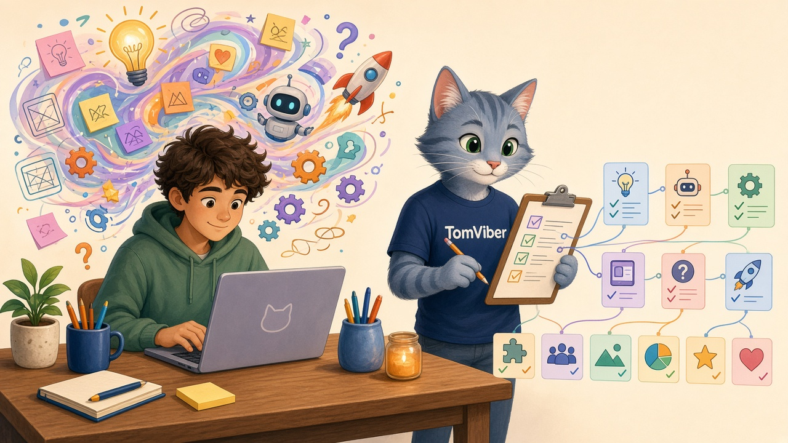

**English | [Русский](README.ru.md) | [简体中文](README.zh-CN.md)**

<div align="center">

# 🐱 TomViber

<p align="center"></p>

**A tech-lead mentor for vibe coders who don't read code.**
An Agent Skill that gives you saves, project memory and a PANIC button — from the very first commit.

[](LICENSE)


</div>

## Before → after

| Without TomViber | With TomViber |
|---|---|
| The agent "just tweaked one thing" and wiped out half your project. Nobody knows what yesterday's version looked like. | You type **PANIC** → the project is back to its last working state, and the broken version is parked on the side. Nothing is lost. |
| Your bot token ended up on GitHub. | Keys go in through a little pop-up window and live in `.env`, which git never sees. |
| Tomorrow the agent has no idea what you did today. | `MEMORY.md` keeps track: where you stopped, what's next, what bit you. |
| "Everything works!" — and it won't even start. | Honest reports: "built it", "ran it", "couldn't verify" — plus exactly what *you* should click to check. |

## Install in a minute

**Easiest:** tell your agent:

> Install the skill from https://github.com/Magnifico4625/TomViber

**Or by hand:** [download the ZIP](https://github.com/Magnifico4625/TomViber/archive/refs/heads/main.zip), unzip it, and drop the `tomviber/` folder into your agent's skills directory:

| Agent | All projects | One project |
|---|---|---|
| Claude Code | `~/.claude/skills/tomviber/` | `.claude/skills/tomviber/` |
| Cursor | `~/.cursor/skills/tomviber/` or `~/.agents/skills/tomviber/` | `.cursor/skills/…` or `.agents/skills/…` |
| Codex | `~/.agents/skills/tomviber/` | `.agents/skills/tomviber/` |
| Other Agent Skills–compatible agents | usually `~/.agents/skills/` | `.agents/skills/` |

<details>
<summary>From the terminal</summary>

```bash
git clone https://github.com/Magnifico4625/TomViber.git
mkdir -p ~/.agents/skills && cp -r TomViber/tomviber ~/.agents/skills/   # Codex, Cursor, others
mkdir -p ~/.claude/skills && cp -r TomViber/tomviber ~/.claude/skills/   # Claude Code
```

```powershell
git clone https://github.com/Magnifico4625/TomViber.git
Copy-Item -Recurse TomViber\tomviber "$HOME\.agents\skills\tomviber"
```
</details>

## Your first message

> I want a Telegram bot that sends me the weather and the dollar rate every morning. I'm not a programmer.

The agent will repeat the idea back in its own words, suggest a scope ("evening prototype"), quietly set up the safety net, and start with the first piece that actually works.

## FAQ

**I don't have git.** The agent will offer to install it (one command on Windows). If that's not possible, it falls back to dated copies of your project folder.

**Does it work on Windows?** Yes. Starting the app and entering keys are double-click `.bat` files. On a Mac they're `.command` files.

**How do I know it's on?** An `AGENTS.md` appears in your project root, starting with `<!-- tomviber v1 -->`. And the agent retells your idea before writing any code.

**What languages does it speak?** It answers in your language. English and Russian are built in; other languages work on a best-effort basis.

**Where do the rules live afterwards?** In your project's `AGENTS.md`. The skill handles kick-off and the "going public" check; day to day, any agent just follows that file.

## Status

Early days. **Not yet systematically tested on any agent.** Issues describing how it went for you (Claude Code, Cursor, Codex, anything else) are very welcome.

## What's inside

```
tomviber/
├── SKILL.md
└── templates/
    ├── AGENTS.md              # project rules: loop, PANIC, data, keys
    ├── MEMORY.md  ARCHITECTURE.md  belt-checklist.md  infra-notes.md
    ├── gitignore.template     # → .gitignore
    ├── dockerignore.template  # → .dockerignore (mode 3)
    └── set-key.bat / set-key.command   # paste a key into .env safely
```

## License

[MIT](LICENSE) © 2026 Damir Damirov ([@Magnifico4625](https://github.com/Magnifico4625))
