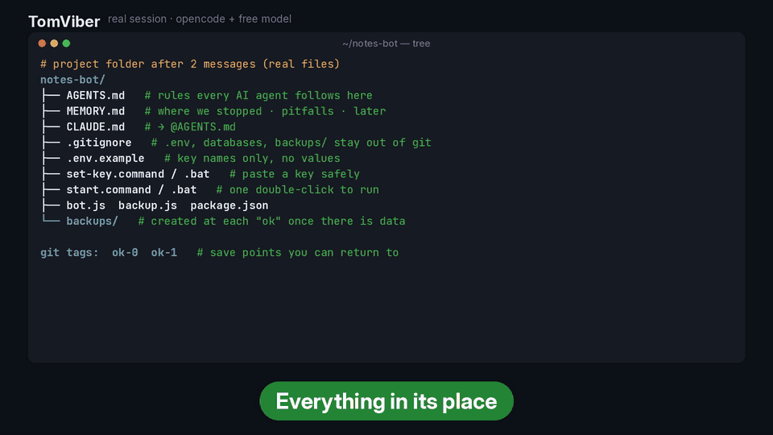

**[English](README.md) | Русский | [简体中文](README.zh-CN.md)**

<div align="center">

# 🐱 TomViber

<p align="center"></p>

<p align="center"></p>
<p align="center"><a href="assets/tomviber-demo.mp4"><b>▶ Смотреть полное демо (77 с, со звуком)</b></a></p>

**Техлид-ментор для вайб-кодеров, которые не читают код.**
Agent Skill: страховка, память проекта и кнопка «ПАНИКА» — с первого коммита.

[](LICENSE)


</div>

## Было → стало

| Без TomViber | С TomViber |
|---|---|
| Агент «чуть-чуть поправил» и снёс полпроекта. Что было вчера — неизвестно. | Пишешь **ПАНИКА** → проект вернулся к последнему рабочему состоянию, а сломанная версия лежит отдельно. Ничего не пропало. |
| Ключ от бота уехал на GitHub. | Ключи вводятся через окошко и живут в `.env`, который git не видит. |
| Завтра агент не помнит, что делали вчера. | `MEMORY.md`: где остановились, что дальше, какие грабли. |
| «Всё работает!» — а оно не запускается. | Честный отчёт: «собрал», «прогнал», «проверить не смог» + что проверить тебе. |

## Установка за минуту

**Проще всего:** напиши своему агенту одну фразу:

> Установи скилл по ссылке https://github.com/Magnifico4625/TomViber

**Или вручную:** [скачай ZIP](https://github.com/Magnifico4625/TomViber/archive/refs/heads/main.zip), распакуй и положи папку `tomviber/` в каталог навыков:

| Агент | Для всех проектов | Только для проекта |
|---|---|---|
| Claude Code | `~/.claude/skills/tomviber/` | `.claude/skills/tomviber/` |
| Cursor | `~/.cursor/skills/tomviber/` или `~/.agents/skills/tomviber/` | `.cursor/skills/…` или `.agents/skills/…` |
| Codex | `~/.agents/skills/tomviber/` | `.agents/skills/tomviber/` |
| Другие агенты с Agent Skills | обычно `~/.agents/skills/` | `.agents/skills/` |

<details>
<summary>Через терминал</summary>

```bash
git clone https://github.com/Magnifico4625/TomViber.git
mkdir -p ~/.agents/skills && cp -r TomViber/tomviber ~/.agents/skills/   # Codex, Cursor, др.
mkdir -p ~/.claude/skills && cp -r TomViber/tomviber ~/.claude/skills/   # Claude Code
```

```powershell
git clone https://github.com/Magnifico4625/TomViber.git
Copy-Item -Recurse TomViber\tomviber "$HOME\.agents\skills\tomviber"
```
</details>

## Первое сообщение

> Хочу Telegram-бота, который каждое утро присылает мне погоду и курс доллара. Я не программист.

Агент перескажет идею, предложит формат («прототип на вечер»), сам поставит страховку и начнёт с первого работающего кусочка.

## FAQ

**У меня нет git.** Агент предложит поставить его (на Windows — одной командой). Если нельзя — будет делать копии папки с датой.

**Работает на Windows?** Да: запуск и ввод ключей — через `.bat`-файлы двойным кликом. На Mac — `.command`.

**Как понять, что скилл включился?** В корне проекта появится `AGENTS.md`, первая строка — `<!-- tomviber v1 -->`. Агент сначала перескажет идею, а не бросится писать код.

**На каком языке он говорит?** На твоём: русский и английский встроены, остальные — по возможности.

**Куда делись правила потом?** В `AGENTS.md` проекта. Скилл нужен для старта и перед показом людям, дальше агент работает по этому файлу.

## Статус

Ранняя версия. **Вручную прогнано целиком на Windows 11** (v0.3, все фазы, включая ПАНИКУ и правило двух попыток). Другие платформы и агенты пока систематически не тестировались — будем рады issue с вашим опытом (Claude Code, Cursor, Codex и др.).

## Структура

```
tomviber/
├── SKILL.md
└── templates/
    ├── AGENTS.md              # правила проекта: цикл, ПАНИКА, данные, ключи
    ├── MEMORY.md  ARCHITECTURE.md  belt-checklist.md  infra-notes.md
    ├── gitignore.template     # → .gitignore
    ├── gitattributes.template # → .gitattributes
    ├── dockerignore.template  # → .dockerignore (режим 3)
    └── set-key.bat / set-key.command   # ввод ключа в .env
```

## Лицензия

[MIT](LICENSE) © 2026 Дамир Дамиров ([@Magnifico4625](https://github.com/Magnifico4625))
